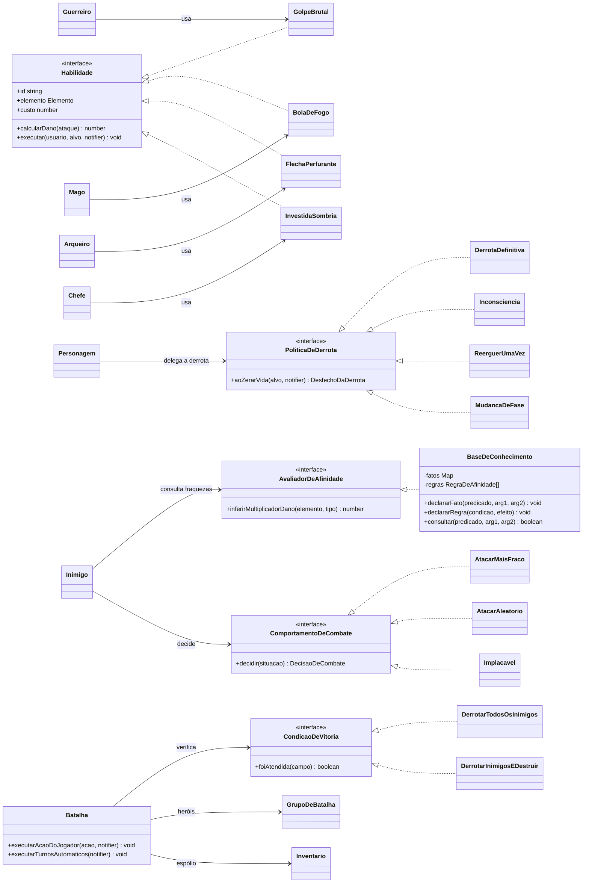
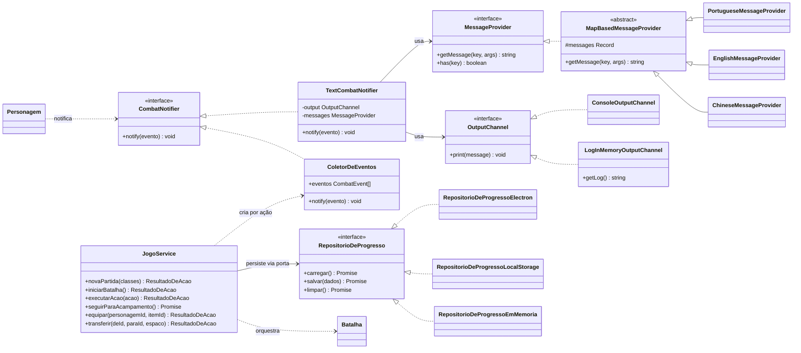

# Diagrama UML de classes

Os diagramas abaixo descrevem as classes **realmente implementadas** em `src/`. A notação segue a usada no PDF:

| Relação | Mermaid | Significado no projeto |
|---|---|---|
| Herança | `<\|--` | `Guerreiro`, `Mago`, `Arqueiro` e `Inimigo` **são um** `Personagem` |
| Realização de interface | `<\|..` | `Personagem`, `Membro`, `Bau` e `Fortaleza` **assinam** `Destrutivel` |
| Composição | `*--` (losango cheio) | `Personagem` **contém** `Membro`: cria no construtor e destrói na derrota definitiva |
| Agregação | `o--` (losango vazio) | `Personagem` **possui** `Arma`/`Armadura`; `Inventario` e `Bau` agregam itens; `GrupoDeBatalha` agrega personagens |
| Associação | `-->` | referência mantida para colaborar (ex.: `Inimigo --> AvaliadorDeAfinidade`) |
| Dependência | `..>` | uso temporário, só durante uma chamada (ex.: `Personagem ..> CombatNotifier`) |

> Este arquivo é lido em tempo de execução pelo **Laboratório de Programação** (`src/presentation/lab/trechos.ts`), que renderiza os blocos Mermaid abaixo. Alterar o diagrama aqui altera o diagrama do jogo.

## 1. Núcleo do domínio: herança, contratos, agregação e composição

```mermaid
classDiagram
    direction TB
    class Destrutivel {
        <<interface>>
        +id string
        +receberDano(valor, notifier, elemento) void
        +estaDestruido() boolean
        +getNome() string
        +getVida() number
        +getVidaMaxima() number
    }
    class ComHabilidadeEspecial {
        <<interface>>
        +usarHabilidade(alvo, notifier) boolean
        +podeUsarHabilidade() boolean
        +getHabilidade() Habilidade
    }
    class ComRecurso {
        <<interface>>
        +getRecurso() Recurso
    }
    class PossuiMana {
        <<interface>>
        +getMana() number
        +restaurarMana(quantidade, notifier) number
    }
    class ContemItens {
        <<interface>>
        +getItens() Item[]
        +retirarItens() Item[]
    }
    class Personagem {
        <<abstract>>
        -nome string
        -vida number
        -vidaMaxima number
        -ataqueBase number
        -membros Membro[]
        -armaEquipada Arma
        -armaduraEquipada Armadura
        +atacar(alvo, notifier) void
        +receberDano(valor, notifier, elemento) void
        +mostrarStatus(notifier) void
        +receberCura(quantidade, notifier) number
        +equiparArma(arma, notifier) Arma
        +droparArmaAoMorrer(notifier) Arma
        +descansar() void
        #calcularDanoRecebido(valor, elemento, notifier) number
    }
    class Guerreiro {
        -furia number
        +usarHabilidade(alvo, notifier) boolean
    }
    class Mago {
        -mana number
        +usarHabilidade(alvo, notifier) boolean
        +restaurarMana(quantidade, notifier) number
    }
    class Arqueiro {
        -flechas number
        +usarHabilidade(alvo, notifier) boolean
    }
    class Inimigo {
        +tipoCriatura string
        #calcularDanoRecebido(valor, elemento, notifier) number
    }
    class Zumbi
    class Chefe {
        +usarHabilidade(alvo, notifier) boolean
    }
    class Membro {
        -integridade number
        -penalidadeDeAtaque number
        +getPenalidadeAtiva() number
    }
    class ItemBase {
        <<interface>>
        +id string
        +catalogoId string
        +getNome() string
    }
    class Arma {
        -bonusAtaque number
        +tipo TipoDeArma
        +getBonusAtaque() number
    }
    class Armadura {
        -defesa number
        +getDefesa() number
    }
    class Consumivel {
        +efeito EfeitoDeConsumivel
    }
    class Inventario {
        -itens Item[]
        +adicionar(item) void
        +retirar(itemId) Item
    }
    class Bau {
        -durabilidade number
    }
    class Fortaleza {
        -blindagem number
    }
    class GrupoDeBatalha {
        +realizarInvestida(alvo, notifier) void
        +desfazer() Personagem[]
    }

    Destrutivel <|.. Personagem : implementa
    Destrutivel <|.. Membro : implementa
    Destrutivel <|.. Bau : implementa
    Destrutivel <|.. Fortaleza : implementa
    ContemItens <|.. Bau : implementa

    Personagem <|-- Guerreiro : herda
    Personagem <|-- Mago : herda
    Personagem <|-- Arqueiro : herda
    Personagem <|-- Inimigo : herda
    Inimigo <|-- Zumbi : herda
    Inimigo <|-- Chefe : herda

    ComHabilidadeEspecial <|.. Guerreiro : implementa
    ComHabilidadeEspecial <|.. Mago : implementa
    ComHabilidadeEspecial <|.. Arqueiro : implementa
    ComHabilidadeEspecial <|.. Chefe : implementa
    ComRecurso <|.. Guerreiro : implementa
    ComRecurso <|.. Mago : implementa
    ComRecurso <|.. Arqueiro : implementa
    PossuiMana <|.. Mago : implementa

    ItemBase <|.. Arma : implementa
    ItemBase <|.. Armadura : implementa
    ItemBase <|.. Consumivel : implementa

    Personagem "1" *-- "1..*" Membro : compõe
    Personagem "1" o-- "0..1" Arma : agrega
    Personagem "1" o-- "0..1" Armadura : agrega
    Inventario "1" o-- "0..*" ItemBase : agrega
    Bau "1" o-- "0..*" ItemBase : agrega
    GrupoDeBatalha "1" o-- "1..*" Personagem : agrega

    Personagem ..> Destrutivel : ataca
```

## 2. Estratégias (OCP) e paradigma lógico

## 3. Internacionalização, saída e aplicação (TOTAL SOLID)

## Observações de fidelidade ao código

- Em TypeScript, `ComHabilidadeEspecial` não existe em tempo de execução; o `instanceof` do PDF é substituído pelo *type guard* `possuiHabilidadeEspecial()` (`src/domain/contracts/ComHabilidadeEspecial.ts`).
- `Item` é o tipo união `Arma | Armadura | Consumivel`; no diagrama ele aparece pelo contrato comum `ItemBase`.
- As habilidades são instanciadas pela própria classe (`private readonly golpeBrutal = new GolpeBrutal()`), mas são objetos sem estado; por isso são representadas como **associação**, e não como composição.
- `CombatNotifier` é uma **interface** no domínio (no PDF era uma classe concreta). A classe do PDF corresponde a `TextCombatNotifier`, na camada de apresentação.
